

  

# International Science Olympiads: All-Time Medal Table 🏅

  
  
  
  
  
  

A curated all-time medal tally and performance statistics for prestigious International Science Olympiads 🌍:
- 💻 **IOI** (International Olympiad in Informatics)
- 📐 **IMO** (International Mathematical Olympiad)
- ⚛️ **IPhO** (International Physics Olympiad)

Compare country rankings by gold 🥇, silver 🥈, bronze 🥉 medals, total counts 📊, and per capita medal metrics 🌐.

---

## 📌 Table of Contents
- [💻 International Olympiad in Informatics (IOI)](#-ioi---international-olympiad-in-informatics)
- [📐 International Mathematical Olympiad (IMO)](#-imo---international-mathematical-olympiad)
- [⚛️ International Physics Olympiad (IPhO)](#️-ipho---international-physics-olympiad)
- [💖 Support &amp; Sponsorship](#-support)
- [📈 Star History](#-star-history)
- [🤝 Contributing](#-contributing)
- [📜 License](#-license)

---

## 💻 IOI - International Olympiad in Informatics

All-time cumulative medal statistics for national teams at the International Olympiad in Informatics (IOI). 🏆

| Country   |      Gold      |  Silver | Bronze | Total | Medals Per Capita| Golds Per Capita|
|----------|:-------------:|------:|------:|------:|------:|------:|
| China                |  92 |  27 |  12 | 131 |    0.93 |    0.66 |
| Russia               |  68 |  40 |  12 | 120 |    8.33 |    4.85 |
| USA                  |  58 |  37 |  16 | 111 |    3.37 |    1.75 |
| South Korea          |  44 |  43 |  28 | 115 |   22.24 |    8.46 |
| Poland               |  41 |  46 |  32 | 119 |   31.39 |   10.78 |
| Romania              |  32 |  53 |  34 | 119 |   61.97 |   16.67 |
| Iran                 |  28 |  61 |  23 | 112 |   13.33 |    3.09 |
| Bulgaria             |  27 |  49 |  39 | 115 |  166.67 |   41.86 |
| Japan                |  27 |  28 |  10 |  65 |    5.17 |    2.16 |
| Slovakia             |  25 |  43 |  34 | 102 |  188.89 |   46.04 |
| India                |   1 |  18 |  36 |  55 |    0.39 |    0.01 |

## 📐 IMO - International Mathematical Olympiad

All-time cumulative medal statistics for national teams at the International Mathematical Olympiad (IMO). 🏆

| Country   |      Gold      |  Silver | Bronze | Total | Honorable Mention | Medals Per Capita| Golds Per Capita|
|----------|:-------------:|------:|------:|------:|:-----------------:|------:|------:|
| China                | 168 |  36 |   6 | 210 |   0 |     1.5 |     1.2 |
| USA                  | 137 | 117 |  29 | 283 |   1 |     8.8 |    4.15 |
| Russia               | 106 |  62 |  12 | 180 |   0 |    12.5 |    7.58 |
| South Korea          |  86 |  74 |  28 | 188 |   7 |    36.4 |   16.63 |
| Hungary              |  85 | 167 | 107 | 359 |  10 |  370.10 |   88.63 |
| Romania              |  78 | 149 | 110 | 337 |   7 |  167.70 |   40.62 |
| USSR                 |  77 |  67 |  45 | 189 |   0 |    6.55 |    2.67 |
| Vietnam              |  65 | 111 |  78 | 254 |   2 |   25.48 |    6.52 |
| Bulgaria             |  55 | 123 | 114 | 292 |  13 |  451.66 |   85.07 |
| Germany              |  53 | 105 |  83 | 241 |  16 |   28.97 |    6.37 |
| United Kingdom       |  51 | 116 | 126 | 293 |  18 |   43.32 |    7.54 |
| Iran                 |  46 | 103 |  48 | 197 |   4 |   22.01 |    5.14 |
| Japan                |  43 |  89 |  49 | 181 |   5 |   14.47 |    3.44 |
| Taiwan               |  42 |  97 |  32 | 171 |   8 |   72.77 |   17.87 |
| Ukraine              |  42 |  71 |  46 | 159 |   9 |   38.73 |   10.23 |
| Canada               |  39 |  61 |  94 | 194 |  19 |   49.81 |   10.01 |
| Poland               |  33 |  89 | 137 | 259 |  27 |   70.34 |    8.96 |
| Thailand             |  30 |  62 |  50 | 142 |  23 |   19.79 |    4.18 |
| Australia            |  26 |  75 |  94 | 195 |  17 |   74.95 |    9.99 |
| France               |  26 |  65 | 121 | 212 |  27 |   31.09 |    3.81 |
| GDR                  |  26 |  62 |  60 | 148 |   0 |   91.93 |   16.15 |
| Singapore            |  22 |  62 |  73 | 157 |  21 |  278.52 |   39.03 |
| North Korea          |  22 |  36 |   9 |  67 |   2 |   25.45 |    8.36 |
| Turkey               |  19 |  63 |  92 | 174 |  14 |   20.48 |    2.24 |
| Israel               |  18 |  59 | 102 | 179 |  23 |  187.29 |   18.83 |
| Italy                |  18 |  47 |  73 | 138 |  35 |   23.38 |    3.05 |
| Kazakhstan           |  16 |  39 |  68 | 123 |  28 |   61.39 |    7.99 |
| Serbia               |  16 |  30 |  33 |  79 |  13 |  118.54 |   24.01 |
| Belarus              |  15 |  55 |  77 | 147 |  17 |  159.30 |   16.25 |
| India                |  13 |  71 |  72 | 156 |  28 |    1.13 |    0.09 |
| Austria              |  13 |  34 | 109 | 156 |  55 |  172.53 |   14.38 |
| Hong Kong            |  12 |  57 |  87 | 156 |  24 |  212.36 |   16.34 |
| Brazil               |  11 |  52 |  84 | 147 |  34 |    6.99 |    0.52 |
| Czechoslovakia       |  10 |  50 |  73 | 133 |   2 |   85.26 |    6.41 |
| Netherlands          |  10 |  33 |  84 | 127 |  48 |   71.75 |    5.65 |
| Czech Republic       |   7 |  36 |  72 | 115 |  39 |  107.76 |    6.56 |
| Sweden               |   7 |  33 |  84 | 124 |  56 |  118.24 |    6.67 |
| Yugoslavia           |   6 |  46 |  96 | 148 |   7 |   62.98 |    2.55 |
| Mongolia             |   6 |  28 |  71 | 105 |  55 |  305.79 |   17.47 |
| Croatia              |   6 |  26 |  77 | 109 |  37 |  282.70 |   15.56 |
| Argentina            |   6 |  25 |  65 |  96 |  45 |   21.14 |    1.32 |
| Slovakia             |   5 |  39 |  78 | 122 |  34 |  224.61 |    9.21 |
| Peru                 |   5 |  37 |  54 |  96 |  33 |   28.68 |    1.49 |
| Indonesia            |   5 |  28 |  51 |  84 |  32 |    3.01 |    0.18 |
| Moldova              |   5 |  23 |  53 |  81 |  45 |  320.33 |   19.77 |
| Mexico               |   4 |  28 |  72 | 104 |  40 |    8.09 |    0.31 |
| Georgia              |   4 |  23 |  71 |  98 |  51 |  263.97 |   10.77 |
| Philippines          |   4 |  16 |  35 |  55 |  26 |    4.83 |    0.35 |
| Malaysia             |   4 |  15 |  27 |  46 |  38 |   13.26 |    1.15 |
| Greece               |   3 |  28 |  75 | 106 |  61 |  101.55 |    2.87 |
| Norway               |   3 |  15 |  37 |  55 |  42 |  100.79 |    5.50 |
| Portugal             |   3 |   7 |  37 |  47 |  40 |   45.04 |    2.88 |
| New Zealand          |   2 |  11 |  58 |  71 |  57 |  139.72 |    3.94 |
| Luxembourg           |   2 |   5 |  23 |  30 |  23 |  459.35 |   30.62 |
| Macau                |   2 |   4 |  31 |  37 |  56 |  546.29 |   29.53 |
| CIS                  |   2 |   3 |   0 |   5 |   1 |    0.18 |    0.07 |
| Armenia              |   1 |  26 |  62 |  89 |  43 |  299.74 |    3.37 |
| Colombia             |   1 |  19 |  77 |  97 |  48 |   18.75 |    0.19 |
| Belgium              |   1 |  18 |  69 |  88 |  64 |   75.34 |    0.86 |
| Switzerland          |   1 |  13 |  55 |  69 |  41 |   78.61 |    1.14 |
| Latvia               |   1 |  11 |  41 |  53 |  61 |  282.01 |    5.32 |
| Finland              |   1 |  10 |  54 |  65 |  64 |  116.99 |    1.80 |
| South Africa         |   1 |   9 |  52 |  62 |  67 |    9.94 |    0.16 |
| Lithuania            |   1 |   8 |  52 |  61 |  56 |  215.42 |    3.53 |
| Slovenia             |   1 |   7 |  39 |  47 |  65 |  222.53 |    4.73 |
| Cuba                 |   1 |   7 |  37 |  45 |  26 |   40.69 |    0.90 |
| Bangladesh           |   1 |   7 |  31 |  39 |  33 |    2.30 |    0.06 |
| Denmark              |   1 |   6 |  37 |  44 |  50 |   74.54 |    1.69 |
| Tunisia              |   1 |   6 |  17 |  24 |  35 |   19.80 |    0.83 |
| Puerto Rico          |   1 |   1 |   7 |   9 |  16 |   27.95 |    3.11 |
| Uzbekistan           |   0 |  10 |  28 |  38 |  42 |   10.88 |    0.00 |
| Estonia              |   0 |   9 |  32 |  41 |  61 |  303.96 |    0.00 |
| Azerbaijan           |   0 |   8 |  39 |  47 |  57 |   46.34 |    0.00 |
| Saudi Arabia         |   0 |   8 |  34 |  42 |  16 |   13.05 |    0.00 |
| Spain                |   0 |   7 |  56 |  63 |  59 |   13.18 |    0.00 |
| Bosnia and Herzegovina |   0 |   6 |  55 |  61 |  59 |  190.34 |    0.00 |
| North Macedonia      |   0 |   6 |  46 |  52 |  44 |  283.89 |    0.00 |
| Tajikistan           |   0 |   5 |  24 |  29 |  45 |   28.48 |    0.00 |
| Syria                |   0 |   5 |  10 |  15 |  30 |    6.68 |    0.00 |
| Serbia and Montenegro |   0 |   5 |   7 |  12 |   3 |   11.43 |    0.00 |
| Morocco              |   0 |   4 |  35 |  39 |  74 |   10.45 |    0.00 |
| Turkmenistan         |   0 |   4 |  32 |  36 |  44 |   49.79 |    0.00 |
| Cyprus               |   0 |   4 |  20 |  24 |  49 |  180.27 |    0.00 |
| Chile                |   0 |   3 |   6 |   9 |  27 |    4.60 |    0.00 |
| Montenegro           |   0 |   3 |   2 |   5 |  16 |   80.18 |    0.00 |
| Ireland              |   0 |   2 |  10 |  12 |  50 |   23.02 |    0.00 |
| Albania              |   0 |   2 |   8 |  10 |  35 |   40.79 |    0.00 |
| Trinidad and Tobago  |   0 |   2 |   5 |   7 |  29 |   51.25 |    0.00 |
| Venezuela            |   0 |   2 |   5 |   7 |  26 |    2.48 |    0.00 |
| Algeria              |   0 |   2 |   5 |   7 |  13 |    1.54 |    0.00 |
| Costa Rica           |   0 |   1 |  18 |  19 |  38 |   37.39 |    0.00 |
| Kyrgyzstan           |   0 |   1 |  12 |  13 |  45 |   18.64 |    0.00 |
| Iceland              |   0 |   1 |  11 |  12 |  40 |  314.13 |    0.00 |
| Paraguay             |   0 |   1 |  11 |  12 |  19 |   17.75 |    0.00 |
| Pakistan             |   0 |   1 |   7 |   8 |  19 |    0.33 |    0.00 |
| Liechtenstein        |   0 |   1 |   4 |   5 |   3 | 1266.05 |    0.00 |
| Ivory Coast          |   0 |   1 |   0 |   1 |   8 |    0.33 |    0.00 |
| Sri Lanka            |   0 |   0 |  23 |  23 |  53 |   10.37 |    0.00 |
| Ecuador              |   0 |   0 |  11 |  11 |  34 |    6.17 |    0.00 |
| El Salvador          |   0 |   0 |   6 |   6 |  29 |    9.55 |    0.00 |
| Nigeria              |   0 |   0 |   5 |   5 |  16 |    0.22 |    0.00 |
| Panama               |   0 |   0 |   5 |   5 |  13 |   11.36 |    0.00 |
| Nicaragua            |   0 |   0 |   3 |   3 |  16 |    4.46 |    0.00 |
| Uruguay              |   0 |   0 |   2 |   2 |  26 |    5.90 |    0.00 |
| Kosovo               |   0 |   0 |   2 |   2 |  20 |   11.31 |    0.00 |
| Honduras             |   0 |   0 |   1 |   1 |   8 |    0.96 |    0.00 |
| Guatemala            |   0 |   0 |   1 |   1 |   6 |    0.56 |    0.00 |
| Iraq                 |   0 |   0 |   1 |   1 |   3 |    0.23 |    0.00 |
| Ghana                |   0 |   0 |   1 |   1 |   2 |    0.30 |    0.00 |
| Kuwait               |   0 |   0 |   1 |   1 |   1 |    2.18 |    0.00 |
| Cambodia             |   0 |   0 |   0 |   0 |  14 |    0.00 |    0.00 |
| Bolivia              |   0 |   0 |   0 |   0 |  12 |    0.00 |    0.00 |
| Myanmar              |   0 |   0 |   0 |   0 |   6 |    0.00 |    0.00 |
| Uganda               |   0 |   0 |   0 |   0 |   5 |    0.00 |    0.00 |
| Botswana             |   0 |   0 |   0 |   0 |   3 |    0.00 |    0.00 |
| Nepal                |   0 |   0 |   0 |   0 |   2 |    0.00 |    0.00 |
| Bahrain              |   0 |   0 |   0 |   0 |   1 |    0.00 |    0.00 |
| Burkina Faso         |   0 |   0 |   0 |   0 |   1 |    0.00 |    0.00 |
| Egypt                |   0 |   0 |   0 |   0 |   1 |    0.00 |    0.00 |
| Tanzania             |   0 |   0 |   0 |   0 |   1 |    0.00 |    0.00 |

## ⚛️ IPhO - International Physics Olympiad

All-time cumulative medal statistics for national teams at the International Physics Olympiad (IPhO). 🏆

| Country   |      Gold      |  Silver | Bronze |Total |Honorable Mention | Medals Per Capita| Golds Per Capita|
|----------|:-------------:|------:|------:|------:|------:|------:|------:|
| China                | 141 |  21 |   9 | 171 |   2 |    1.22 |    1.01 |
| South Korea          |  83 |  27 |  24 | 134 |   7 |   25.91 |   16.05 |
| Russia               |  82 |  46 |  10 | 138 |   4 |    9.58 |    5.85 |
| Taiwan               |  77 |  32 |  18 | 127 |   8 |   54.04 |   32.76 |
| India                |  46 |  48 |  14 | 108 |   3 |    0.78 |    0.33 |

---

## 💖 Support

Thank you so much for visiting this repository! 🌟 If you found this compilation useful or insightful, please consider:
- ⭐ **Starring** this repository to help others discover it
- 🍴 **Forking** and contributing additional data, charts, or updates
- 📢 **Sharing** this repository with fellow students, teachers, and competitive programming/math enthusiasts
- ☕ **Buying a coffee / sponsoring** the project via the [GitHub Sponsor Dashboard](https://github.com/sponsors/ishandutta2007)

---

## 📈 Star History

---

## 🤝 Contributing
Contributions, updates, and corrections to the medal records are welcome! Feel free to submit a pull request or open an issue. 🚀

---

## 📜 License
This project is open-source and available under the [MIT License](LICENSE). 📄
